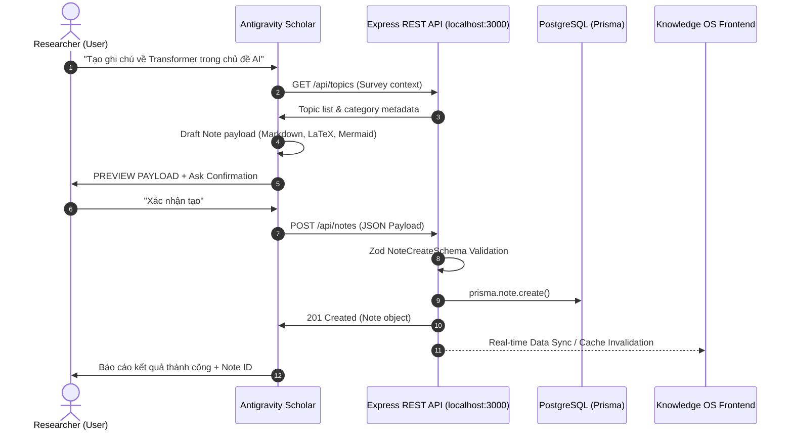

# ADR-118: Research Scholar Controlled Write Architecture v1

- **Status:** PROPOSED (Gate 1 Baseline)
- **Date:** 2026-11-01
- **Author:** Staff Software Engineer / Technical Architect
- **Context:** Integration of Antigravity AI Agent with Knowledge OS as an Autonomous Research Scholar

---

## 1. Context & Problem Statement

Knowledge OS (`Dashboard-update`) is a local-first learning operating system combining dynamic domain taxonomies, topic hierarchies, Markdown notes, spaced repetition (SM-2) flashcards, and reading resources.

Previously, Antigravity interacted with the repository strictly as a software engineer/maintainer (code edits, test guards, bug fixes). The user now requires Antigravity to act as an **Academic Research Scholar & Knowledge Operator** — creating research domains, structuring topic trees, authoring comprehensive study notes, ingesting references, and compiling flashcard decks for daily review.

However, operating directly on the production database or exposing uncontrolled deletion endpoints introduces critical risks:
1. **Cascade Delete Blast Radius**: In `prisma/schema.prisma`, deleting a Category cascades to all its Topics, which in turn cascades to all Resources, Flashcards, and Progress records.
2. **Database Reset Endpoint**: `POST /api/data/reset` permanently wipes all user knowledge.
3. **No Authentication Boundary**: Knowledge OS operates on `localhost:3000` without bearer tokens or user roles; any local HTTP client can mutate records.
4. **Direct Database Corruption**: A Prisma direct bridge bypasses Zod input schemas, lifecycle hooks, and real-time UI hydration.

A formal architectural contract is required to govern how Antigravity interacts with Knowledge OS safely and deterministically.

---

## 2. Decision

We establish the **Research Scholar — Controlled Write v1** architectural pattern:

1. **REST API-First Boundary**:
   Antigravity communicates with Knowledge OS exclusively via HTTP REST endpoints hosted on `http://localhost:3000/api`. The server must be active during mutation sessions.
2. **No Direct Database Bypass**:
   Prisma Direct Bridge (scripts directly invoking `@prisma/client`) is **STRICTLY FORBIDDEN** for data creation, modification, or deletion in MVP.
3. **Strict Whitelist of Allowed Endpoints (Controlled Write MVP)**:
   - Creation (5 endpoints):
     - `POST /api/categories`
     - `POST /api/topics`
     - `POST /api/notes`
     - `POST /api/flashcards`
     - `POST /api/resources`
   - Single-Item Controlled Deletion (2 endpoints):
     - `DELETE /api/notes/:id`
     - `DELETE /api/flashcards/:id`
   - Read-Only Inspection (All GET endpoints):
     - `GET /api/categories`, `GET /api/topics`, `GET /api/notes`, `GET /api/flashcards`, `GET /api/resources`, `GET /api/docs`.
4. **Hard-Locked Endpoints (Forbidden in MVP)**:
   - ⛔ `DELETE /api/categories/:id` (Permanent block — prevents catastrophic taxonomy wipeout).
   - ⛔ `DELETE /api/topics/:id` (Permanent block — prevents cascade deletion of notes/resources/cards).
   - ⛔ `POST /api/data/reset` (Permanent block — prevents full database zero-default reset).
   - ⛔ `POST /api/backup/restore` (Permanent block — prevents database state overwrites).
5. **Human-in-the-Loop Confirmation Gate**:
   Every write operation (`POST` or `DELETE`) MUST present a structured preview payload and receive explicit confirmation from the user before the HTTP transport call is issued.
6. **Zero-Default Universal Baseline Compliance**:
   The Research Scholar must never hardcode or inject predetermined domain names (e.g. legacy domains) during initialization or automated routines. Domains and topics are created strictly upon user instruction.

---

## 3. Interaction Architecture

---

## 4. Risks & Mitigations

| Risk | Impact | Mitigation Strategy |
| :--- | :--- | :--- |
| **Cascade Delete** | Deleting 1 topic erases dozens of flashcards and resources | **Hard Lock**: Completely lock `DELETE /api/categories/:id` and `DELETE /api/topics/:id` from the Scholar skill. |
| **No Localhost Auth** | Malformed script could write invalid data | **REST API-First**: All requests pass through existing strict Zod schemas (`src/lib/validation.ts`). |
| **Server Offline** | HTTP request fails if `npm run dev` is not running | **Health Check First**: Scholar checks `GET /api/health` before initiating write workflows. |
| **XSS / Markdown Corruption** | Malformed Markdown breaking UI rendering | **Markdown Standards**: Note content stored as raw UTF-8 string; UI utilizes isolated KaTeX and Mermaid runtime renderers. |
| **Accidental Deletion** | User accidentally loses an essential note | **Two-Step Confirmation**: Scholar must display note title and ID and require confirmation before calling `DELETE /api/notes/:id`. |

---

## 5. Acceptance Criteria

1. **Endpoint Alignment**: Allowed endpoints correspond 100% to live Express routes and Zod schemas in `Dashboard-update`.
2. **Zero Forbidden Access**: Scholar skill instructions explicitly bar invocation of locked destructive endpoints.
3. **Non-Destructive Baseline**: No changes to existing runtime schema, routes, or tests in `Dashboard-update`.
4. **Deterministic Confirmation**: Skill specifies unambiguous confirmation templates for every mutation intent.

---

## 6. E2E Validation Results (2026-11-01)

The Controlled Write MVP v1 architecture was formally validated through an end-to-end trial against the live server (`http://localhost:3000/api`):
1. **Creation Sequence via REST**: Successfully created Category (`30770729-5187-4ea4-afb6-6326a1900583`), Topic (`b1e87c31-5c67-4c60-a7aa-68f498586364`), Note (`167cfd48-c7c2-4c69-8eee-fdfe10936143`), and two Flashcards (`149b955b-ac80-4031-b05d-26242febd9a4` & `38683815-f79c-4f22-b132-a6d403261702`).
2. **Verification via GET**: Each creation step was independently verified via subsequent `GET` requests (`/api/categories`, `/api/topics`, `/api/notes`, `/api/flashcards?topicId=...`).
3. **Format Preservation**: Full Markdown formatting, LaTeX formulas (`$\text{Attention}...$`), and Mermaid diagrams (`graph TD`) were persisted without escaping or character corruption.
4. **SRS Schedules Initialized**: Flashcards were created with native SM-2 schedules (`state: "new"`, `interval: 0`, `easeFactor: 2.5`).
5. **Hard-Block Defense Verification**: The Agent explicitly and successfully refused requests to delete the topic (`DELETE /api/topics/:id`) and wipe the database (`POST /api/data/reset`), citing ADR-118 and SKILL.md invariants.
6. **Integrity & Zero-Blast-Radius**: No forbidden endpoints, Prisma direct bridge writes, git commits, pushes, PRs, merges, or deploys occurred during the trial.
7. **Contract Correction**: Identified that `CategoryCreateSchema` requires `slug` at schema level; updated API contract to reflect `slug` as a required field for `POST /api/categories`.

---

## 7. Future Phases

- **Phase 2 (Bulk Operations & Excerpts)**: Support batch flashcard generation from attached books/excerpts via `/api/excerpts`.
- **Phase 3 (Obsidian Scholar Roundtrip)**: Bi-directional synchronization between local Obsidian Markdown vaults and Knowledge OS database notes.
