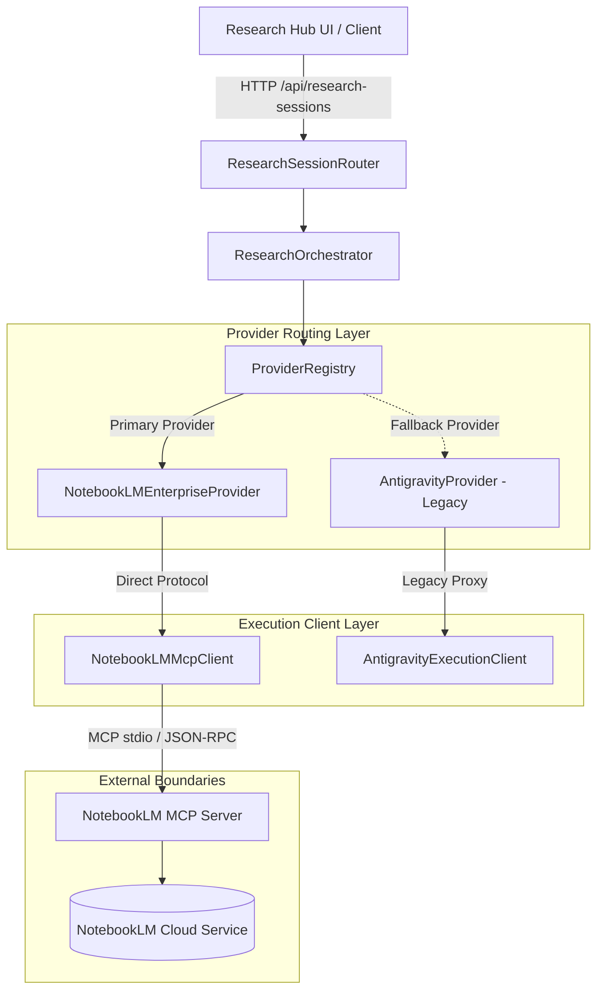

# Session Log — NotebookLM Direct MCP Upgrade Planning

## 1. Thông Tin Phiên Làm Việc (Session Metadata)
- **Đường dẫn dự án:** `/Users/mr.chem/Documents/Lap-trinh/Dashboard-update`
- **Chủ đề:** Kiểm toán kiến trúc (Architecture Audit) và lập kế hoạch kỹ thuật (Implementation Planning) cho việc nâng cấp Research Hub kết nối trực tiếp NotebookLM thông qua giao thức MCP (Model Context Protocol), chuyển dịch vai trò của Antigravity từ trung gian bắt buộc sang cơ chế dự phòng tương thích (fallback/compatibility mode).
- **Thời gian:** 2026-10-15
- **Branch:** `main` (đồng bộ hoàn toàn với `origin/main` tại commit `a1d2a9c`)
- **Role:** Staff Software Engineer / AI & Research Infrastructure Architect
- **Trạng thái:** 🔍 **Hoàn tất kiểm toán & lập kế hoạch kỹ thuật (Audit & Planning Only)**. Chưa can thiệp mã nguồn runtime, chưa sửa đổi cờ cấu hình môi trường, chưa kích hoạt thực thi trực tiếp.

---

## 2. Bối Cảnh & Mục Tiêu Kỹ Thuật (Context & Technical Scope)

### 2.1. Nhu Cầu Nâng Cấp
- Trong các giai đoạn trước (Phase 5 & Phase 6), hạ tầng nghiên cứu của Knowledge OS được thiết kế xoay quanh Antigravity đóng vai trò tác nhân điều phối và proxy trung gian cho các tác vụ tổng hợp tài liệu từ NotebookLM.
- Với sự hoàn thiện của giao thức MCP chuẩn hóa và nhu cầu vận hành độc lập, hệ thống cần nâng cấp để **kết nối trực tiếp NotebookLM qua MCP**.
- Việc kết nối trực tiếp qua MCP giúp:
  1. Loại bỏ độ trễ và các lớp trung gian không cần thiết của proxy cũ.
  2. Khai thác trọn vẹn khả năng truy vấn ngữ cảnh sâu, tổng hợp nguồn tài liệu và tạo artifact của NotebookLM thông qua các MCP tool chuẩn.
  3. Giữ Antigravity ở vị trí cơ chế dự phòng an toàn (legacy fallback), kích hoạt tự động khi runtime MCP gặp sự cố hoặc môi trường không khả dụng.

### 2.2. Ranh Giới Kỹ Thuật & Non-Goals (Boundaries & Non-Goals)
- **Zero Database Migration:** Không thay đổi Prisma schema, không làm xáo trộn cấu trúc các bảng `ResearchSession`, `ResearchSource`, hay `Artifact`.
- **Preserve Orchestration Contracts:** Giữ nguyên các abstraction và ranh giới kiến trúc đã kiểm chứng: `ResearchProvider`, `ProviderRegistry`, `ResearchOrchestrator`, `ResearchPersistencePort`.
- **No Hardcoded Credentials:** Tuyệt đối không nhúng token xác thực, cookie hay secret vào codebase; cấu hình kết nối MCP phải được trừu tượng hóa và nạp qua biến môi trường an toàn.
- **Fail-Safe Defaults:** Không kích hoạt live execution ngầm; duy trì trạng thái an toàn mặc định cho đến khi các quality gates kiểm thử được chứng minh xanh hoàn toàn.
- **Phạm vi phiên này:** Dừng lại ở mức đánh giá hiện trạng, chẩn đoán điểm nghẽn và xác lập tài liệu đặc tả nâng cấp chi tiết. Không viết code runtime trong phiên này.

---

## 3. Kết Quả Kiểm Toán Kiến Trúc Hiện Tại (Architecture Audit)

Qua quá trình rà soát trực tiếp mã nguồn tại các module cốt lõi của máy chủ (`server.ts`, `src/server/config/`, `src/server/bootstrap/`), các kết quả xác thực sự thật kỹ thuật được ghi nhận như sau:

### 3.1. Server Bootstrap & Research Routing (`server.ts`)
- Máy chủ Express đã được module hóa chặt chẽ thông qua hàm tạo pure `createServerApp(deps?: ServerAppDeps)`.
- Các router nghiên cứu đã được cấu hình và gắn kết rõ ràng:
  - `createGeminiRouter`: Tuyến xử lý AI Gemini hỗ trợ phân tích và trích xuất.
  - `createResearchSessionRouter`: Tuyến xử lý phiên nghiên cứu của Research Hub v2.1 pipeline.
  - Tuyến chẩn đoán runtime được tích hợp qua `createResearchProviderRuntimeDiagnostics()`.
- Điểm vào máy chủ đã chuẩn bị sẵn seam để tiêm phụ thuộc (dependency injection seam) thông qua `ServerAppDeps.researchDiagnostics`.

### 3.2. Cấu Hình Nhà Cung Cấp Nghiên Cứu (`src/server/config/researchProviderConfig.ts`)
- Đã tồn tại định nghĩa kiểu `ResearchProviderConfig` với đầy đủ các cờ kiểm soát tính năng:
  - `enableProviderRouting: boolean`: Kích hoạt bộ định tuyến provider động.
  - `defaultProviderId: string`: Định danh provider mặc định.
  - `allowNotebookLM: boolean`: Cho phép truy cập provider NotebookLM.
  - `allowProviderFallback: boolean`: Cho phép tự động chuyển đổi sang provider dự phòng khi có lỗi.
  - `enableMcpServer: boolean`: Kích hoạt máy chủ/client MCP nội bộ.
- Danh sách provider được phê duyệt (`APPROVED_PROVIDER_IDS`):
  - `LEGACY`: `"antigravity-legacy"`
  - `NOTEBOOKLM_ENTERPRISE`: `"notebooklm-enterprise"`
- **Trạng thái mặc định an toàn (`DEFAULT_RESEARCH_PROVIDER_CONFIG`):**
  ```typescript
  export const DEFAULT_RESEARCH_PROVIDER_CONFIG = Object.freeze({
    enableProviderRouting: false,
    defaultProviderId: APPROVED_PROVIDER_IDS.LEGACY,
    allowNotebookLM: false,
    allowProviderFallback: true,
    enableMcpServer: false,
  });
  ```
  *Nhận xét:* Hệ thống hiện tại đang mặc định tắt routing, từ chối NotebookLM và tắt MCP server.

### 3.3. Hàng Rào Chính Sách Thực Thi (`DEFAULT_RESEARCH_EXECUTION_POLICY`)
- Tại `src/server/config/researchProviderConfig.ts`, chính sách thực thi `ResearchExecutionPolicy` đang được khóa ở chế độ mô phỏng nghiêm ngặt:
  ```typescript
  export const DEFAULT_RESEARCH_EXECUTION_POLICY = Object.freeze({
    simulationOnly: true,
    realExecutionEnabled: false,
    requireManualApproval: true,
    allowNotebookLM: false,
    allowAntigravity: false,
  });
  ```
  *Nhận xét:* Bất kỳ yêu cầu thực thi nào cũng đang bị chặn bởi lớp bảo vệ này nhằm ngăn ngừa các lệnh gọi dịch vụ ngoài ngoài kiểm soát.

### 3.4. Khởi Tạo & Ghép Nối Phụ Thuộc (`src/server/bootstrap/researchProviderComposition.ts`)
- Hàm `composeResearchProviderDependencies` và `createDefaultProviderRegistry` phụ trách khởi tạo toàn bộ hạ tầng provider.
- Hiện tại, việc ghép nối provider đang sử dụng:
  - `AntigravityProvider`: Xử lý luồng legacy.
  - `NotebookLMEnterpriseProvider`: Được tiêm cứng một client giả lập:
    ```typescript
    const providers: ResearchProvider[] = [
      new AntigravityProvider(),
      new NotebookLMEnterpriseProvider(new MockNotebookLMClient()),
    ];
    ```
  *Nhận xét:* Lớp `NotebookLMEnterpriseProvider` đã sẵn sàng nhưng đang bị nối vào `MockNotebookLMClient`, trả về dữ liệu mẫu in-memory thay vì thực thi truy vấn qua MCP protocol thật.

---

## 4. Chẩn Đoán Kỹ Thuật (Technical Diagnosis)

### 4.1. Gốc Rễ Vấn Đề (Root Cause Analysis)
1. **Khung kiến trúc (Architectural Skeleton) đã hoàn chỉnh:** Hệ thống không cần đập đi xây lại. Toàn bộ chuỗi `ProviderRegistry -> ResearchOrchestrator -> ResearchProvider -> ResponseTransformer` đã được trừu tượng hóa đúng đắn.
2. **Điểm nghẽn Client Thực Thi (Execution Client Bottleneck):** Điểm nghẽn cốt lõi nằm ở việc `NotebookLMEnterpriseProvider` đang nhận instance của `MockNotebookLMClient`. Cần thay thế client này bằng một `NotebookLMMcpClient` thực thụ kết nối qua MCP.
3. **Khóa Cấu Hình & Chính Sách (Config & Policy Gating):** Các cờ `enableProviderRouting`, `allowNotebookLM`, `enableMcpServer` và chính sách `simulationOnly: true` đang khóa toàn bộ luồng trực tiếp.

### 4.2. Kiến Trúc Đích (Target Architecture)


- **Luồng chính (Happy Path):** `ResearchOrchestrator` định tuyến yêu cầu sang `NotebookLMEnterpriseProvider` -> gọi `NotebookLMMcpClient` -> tương tác với NotebookLM qua MCP.
- **Luồng dự phòng (Fallback Path):** Khi MCP Server mất kết nối hoặc trả về lỗi hạ tầng, `ProviderRegistry` tự động bắt lỗi và chuyển giao sang `AntigravityProvider` nếu `allowProviderFallback === true`.

---

## 5. Quyết Định Kiến Trúc Đề Xuất (Proposed ADR Summary)

- **Quyết định:**
  1. Xây dựng class `NotebookLMMcpClient` hiện thực hóa interface `NotebookLMClient`.
  2. Sử dụng cơ chế kết nối MCP chuẩn (JSON-RPC over stdio / child process wrapper hoặc socket bridge) có timeout, retry và health-check.
  3. Cập nhật `createDefaultProviderRegistry` trong `src/server/bootstrap/researchProviderComposition.ts` để tiêm `NotebookLMMcpClient` thay cho `MockNotebookLMClient` khi cờ `enableMcpServer` hoặc `allowNotebookLM` được bật.
  4. Mở rộng cấu hình môi trường để cấu hình endpoint/lệnh khởi chạy MCP server mà không hardcode đường dẫn.
- **Lý do lựa chọn:**
  - Giữ blast radius ở mức tối thiểu: Không làm thay đổi interface `NotebookLMClient`, không ảnh hưởng tới `ResearchOrchestrator` hay `ResearchPersistencePort`.
  - Đảm bảo tính dễ kiểm thử: Có thể dễ dàng mock client trong test suite thông qua interface có sẵn.
- **Trade-offs & Rủi ro chấp nhận:**
  - Vòng đời tiến trình MCP (Process Lifecycle Management): Cần xử lý ngắt kết nối đột ngột, dọn dẹp child process (orphan process prevention) khi Express server shutdown.
  - Độ trễ khởi động MCP: Cần cơ chế khởi tạo trễ (lazy initialization) hoặc pool kết nối để không làm nghẽn tiến trình bootstrap server.

---

## 6. Kế Hoạch Nâng Cấp Từng Bước (Implementation Planning)

Kế hoạch nâng cấp được chia làm 4 giai đoạn độc lập, kiểm soát bằng quality gates nghiêm ngặt:

### Pha 1 — Chuẩn Hóa Hợp Đồng & Kiểm Thử Cô Lập (Audit & Contract Stabilization)
- Rà soát toàn bộ method signature trong `NotebookLMClient` (`query`, `summarize`, `listSources`, `healthCheck`).
- Tạo bộ fixture và mock contract tests kiểm tra tính tương thích giữa đầu ra của MCP Tool và định dạng mà `NotebookLMEnterpriseProvider` kỳ vọng.
- Thiết lập cơ chế bẫy lỗi (error mapping) từ mã lỗi MCP JSON-RPC sang mã lỗi domain chuẩn của Knowledge OS.

### Pha 2 — Hiện Thực Hóa MCP Client Thật (Real MCP Client Wiring)
- Tạo mới `src/server/services/providers/notebooklmMcpClient.ts` hiện thực interface `NotebookLMClient`.
- Tích hợp client MCP (sử dụng `@modelcontextprotocol/sdk` hoặc giao thức JSON-RPC stdio chuẩn).
- Triển khai circuit breaker và timeout guard: Nếu MCP không phản hồi trong khoảng thời gian quy định (ví dụ: 15s), tự động fail-fast để kích hoạt fallback.
- Bổ sung unit tests cho `NotebookLMMcpClient` sử dụng in-memory stream mock.

### Pha 3 — Ghép Nối Cấu Hình & Bật Cờ Tính Năng (Feature Flags & Composition Enablement)
- Cập nhật `src/server/bootstrap/researchProviderComposition.ts` để tiêm `NotebookLMMcpClient` dựa trên cấu hình `ResearchProviderConfig`.
- Cung cấp cơ chế graceful degradation: Nếu cấu hình MCP không hợp lệ, fallback về `MockNotebookLMClient` (khi test) hoặc `AntigravityProvider` (khi production).
- Mở rộng endpoint chẩn đoán `/api/research-sessions/diagnostics` để phản ánh trạng thái sống của kết nối MCP (`mcpConnected: boolean`, `latencyMs: number`).

### Pha 4 — Bảo Toàn Tương Thích Giao Diện & Bàn Giao (UI Compatibility & Handoff)
- Kiểm tra tính tương thích của frontend `NotebookLMStudioModal.tsx` và `ResearchSessionView.tsx`.
- Hiển thị badge trực quan trên giao diện: Báo rõ nguồn dữ liệu đang đến từ "Direct MCP" hay "Legacy Fallback".
- Chạy toàn bộ regression test suite của toàn dự án, cập nhật `PROJECT_STATUS.md` và closure report.

---

## 7. Thiết Kế Kiểm Thử Test-First (Executable Test Plan)

Để bảo đảm tính ổn định tuyệt đối trước khi viết code, tối thiểu 7 kịch bản Gherkin sau sẽ được chuyển hóa thành executable integration/unit tests:

```gherkin
Feature: NotebookLM Direct MCP Execution and Fallback Routing

  Scenario 1: Direct MCP Execution Success (Primary Happy Path)
    Given Provider routing is enabled and NotebookLM is allowed
    And NotebookLM MCP client connects successfully to the MCP server
    When a research query is submitted to the orchestrator
    Then the request is handled by NotebookLMEnterpriseProvider via MCP
    And the response contains verified NotebookLM citations and artifacts
    And AntigravityProvider is not invoked

  Scenario 2: MCP Server Unreachable - Automatic Fallback
    Given Provider routing is enabled and allowProviderFallback is true
    And the NotebookLM MCP client fails with a connection refused error
    When a research query is submitted to the orchestrator
    Then the system logs a structured warning event
    And the orchestrator seamlessly delegates execution to AntigravityProvider
    And the user receives a successful result marked with fallback metadata

  Scenario 3: Provider Routing Disabled - Safe Legacy Mode
    Given enableProviderRouting is false in server configuration
    When the server dependency composition initializes
    Then orchestrator and registry remain disabled
    And the server operates in safe legacy mode without attempting MCP connection

  Scenario 4: Policy Simulation Enforcement
    Given the execution policy has simulationOnly set to true
    When an execution request reaches the provider registry
    Then real MCP tool execution is blocked
    And a simulated mock response is returned with explicit simulation headers

  Scenario 5: MCP Timeout and Circuit Breaker
    Given the MCP server hangs and exceeds the 15-second execution deadline
    When a synthesis request is processed
    Then the MCP client terminates the hanging call cleanly
    And triggers the circuit breaker to prevent cascade failure
    And routes to fallback provider if enabled

  Scenario 6: Malformed MCP Response Handling
    Given the MCP tool returns a payload violating the expected JSON schema
    When the client parses the response
    Then a strict Zod validation error is caught
    And the error is mapped to an internal DomainError without crashing the Express process

  Scenario 7: Diagnostics Endpoint Integrity
    Given the server is running with direct MCP configured
    When GET /api/research-sessions/diagnostics is requested
    Then the response reports accurate provider readiness, capabilities, and MCP ping status
```

### Quality Gates Tiêu Chuẩn Cho Pha Triển Khai:
1. `npm run typecheck`: 0 lỗi TypeScript.
2. Targeted Vitest tests: 100% PASS cho toàn bộ các kịch bản MCP client và composition.
3. Full test suite: Duy trì >503 test files GREEN, 0 test hồi quy bị hỏng.
4. Process safety: Kiểm chứng không rò rỉ tiến trình con (child processes) sau khi kết thúc test.

---

## 8. Quản Lý Điểm Nhạy Cảm & Vùng Ảnh Hưởng (Blast Radius & Sensitivity Points)

| Điểm nhạy cảm | Rủi ro tiềm ẩn | Biện pháp kiểm soát & Phòng vệ |
| :--- | :--- | :--- |
| **Bảo mật thông tin (Secrets & Tokens)** | Lộ thông tin nhạy cảm hoặc token truy cập NotebookLM trong logs hoặc code. | Không ghi token vào logs; chỉ sử dụng cơ chế truyền credential qua môi trường bảo mật của hệ điều hành. |
| **Treo tiến trình (Orphan Child Process)** | MCP client stdio tạo child process nhưng không đóng khi server restart hoặc test xong. | Đăng ký hook dọn dẹp `process.on('SIGINT')`, `process.on('SIGTERM')` và `beforeExit` để kill process tree sạch sẽ. |
| **Sập luồng nghiên cứu (Cascading Failure)** | MCP server bên ngoài bị lỗi kéo theo sập toàn bộ các route nghiên cứu khác. | Bao bọc toàn bộ lời gọi trong khối `try/catch` có giới hạn thời gian (timeout) và tự động kích hoạt fallback sang Antigravity. |
| **Phá vỡ các module khác** | Sửa đổi làm ảnh hưởng tới Mind Map, Flashcards hoặc Reader. | Cách ly 100% thay đổi bên trong thư mục `src/server/services/providers/`; giữ nguyên contract API của `ResearchSessionRouter`. |

---

## 9. Định Hướng Triển Khai Cho Antigravity (Implementation Coordination)

- **Nguyên tắc cốt lõi:**
  1. *Read-before-write:* Đọc kỹ interface `NotebookLMClient` và các test hiện hữu tại `tests/unit/notebooklm-provider.test.ts` trước khi can thiệp.
  2. *Test-first:* Viết bộ test failing mô phỏng MCP server trước khi hiện thực hóa `NotebookLMMcpClient`.
  3. *No big rewrite:* Từng bước thay thế seam, kiểm tra độ bền vững tại mỗi bước, giữ nguyên 100% logic persistence và validation hiện có.
- **Tài liệu phối hợp:**
  - Prompt điều phối thực thi chi tiết cho các lượt làm việc tiếp theo đã được chuẩn bị riêng, bám sát các ràng buộc không commit vội vàng, chạy đầy đủ 9 bước verification và tuân thủ blast radius tối thiểu.

---

## 10. Trạng Thái Kết Thúc Phiên (Session Closure State)

### 10.1. Thành Quả Đạt Được
- Hoàn tất kiểm toán 100% hiện trạng cấu hình máy chủ, routing và composition của hệ thống Research Provider.
- Xác định chính xác vị trí cần nâng cấp: Thay thế `MockNotebookLMClient` bằng `NotebookLMMcpClient` và mở cờ cấu hình có kiểm soát.
- Xây dựng bản kế hoạch nâng cấp 4 pha toàn diện, đi kèm 7 kịch bản Gherkin kiểm thử test-first và phân tích vùng ảnh hưởng.

### 10.2. Những Việc Chưa Thực Hiện Trong Phiên Này
- Chưa tạo mới file code implementation nào.
- Chưa thay đổi file `src/server/config/researchProviderConfig.ts` hay `src/server/bootstrap/researchProviderComposition.ts`.
- Chưa thay đổi biến môi trường thực tế.

### 10.3. Bước Tiếp Theo Đề Xuất
- Trình người phụ trách phê duyệt kế hoạch nâng cấp kiến trúc Direct MCP.
- Sau khi được duyệt, tiến hành **Pha 1 & Pha 2**: Khởi tạo `tests/unit/notebooklm-mcp-client.test.ts` và hiện thực hóa `NotebookLMMcpClient` theo quy trình test-first.
