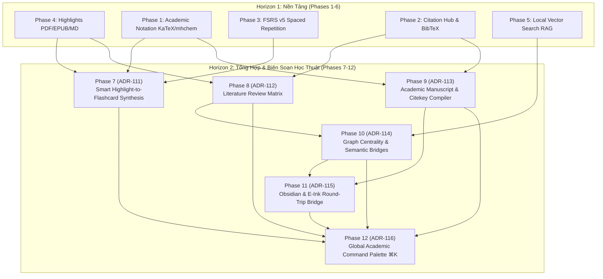

# Academic Research OS — Horizon 2 Master Architecture Plan (Phases 7 to 12)

> **Tầm nhìn (Vision):** Nâng cấp Knowledge OS từ trạm nghiên cứu cá nhân (Horizon 1: Phases 1–6) thành Hệ điều hành Nghiên cứu Hàn lâm Toàn diện (**Academic Research Operating System - AROS**), kết nối liền mạch từ đọc tài liệu, ghi chú, trích đoạn, tổng hợp thẻ nhớ FSRS, ma trận tổng quan tài liệu, đến biên soạn bản thảo luận văn và xuất bản học thuật.

---

## 1. Tổng Quan Tiến Độ Horizon 1 (Phases 1 – 6) — Hoàn Tất

| Phase | ADR | Tiêu Đề | Trạng Thái |
|---|---|---|---|
| **Phase 1** | `ADR-105` | Academic Notation Engine (KaTeX + mhchem + LRU Cache) | ✅ Hoàn thành |
| **Phase 2** | `ADR-106` | Reference & Citation Hub (BibTeX, APA, MLA, Chicago) | ✅ Hoàn thành |
| **Phase 3** | `ADR-107` | FSRS v5 Spaced Repetition Engine (DSR Model) | ✅ Hoàn thành |
| **Phase 4** | `ADR-108` | PDF Text Layer & Persistent Highlights Layer | ✅ Hoàn thành |
| **Phase 5** | `ADR-109` | Local Knowledge Copilot (Vector Search & Hybrid RAG) | ✅ Hoàn thành |
| **Phase 6** | `ADR-110` | Guarded Auto-Backup & Reliability Infrastructure | ✅ Hoàn thành |

---

## 2. Lộ Trình Horizon 2 (Phases 7 – 12) — Kiến Trúc Tổng Thể

---

## 3. Chi Tiết Các Phase Trong Horizon 2

### 📌 Phase 7: Smart Highlight-to-Flashcard & Cloze Synthesis Engine (`ADR-111`)
- **Mục tiêu:** Cầu nối trực tiếp giữa **Phase 4** (Persistent Highlights), **Phase 1** (KaTeX/mhchem), và **Phase 3** (FSRS v5).
- **Tính năng cốt lõi:**
  - Tự động nhận diện thuật ngữ then chốt, công thức toán/hóa học, định nghĩa để biến thành Cloze Deletion (`{{c1::...}}`) không làm vỡ ngoặc nhọn TeX lồng nhau.
  - Hỗ trợ đa chiến lược tổng hợp: `'cloze-auto'`, `'definition-split'`, `'qa-note'`, `'auto'`.
  - Giữ vững xuất xứ học thuật (Deep-Link Provenance Footer) dẫn thẳng về tài liệu PDF (trang), EPUB (CFI), Markdown.
  - Bộ lọc batch synthesis theo màu highlight và cơ chế deduplication guard chống tạo trùng thẻ.
  - Giao diện Flashcard Studio Modal & 1-click synthesis từ ReaderSidebar.

### 📌 Phase 8: Literature Review Synthesis Matrix (`ADR-112`)
- **Mục tiêu:** Bảng ma trận so sánh chéo đa tài liệu (Literature Review Matrix).
- **Tính năng cốt lõi:**
  - Cho phép chọn nhiều tài liệu/bài báo theo chủ đề (`topicId`).
  - Ma trận hiển thị cột là các tiêu chí so sánh (Phương pháp, Dữ liệu thực nghiệm, Kết quả, Giới hạn, Trích dẫn phản biện).
  - Trích xuất dữ liệu tự động từ các trích đoạn `ResearchExcerpt` và `CitationSnapshot`.
  - Xuất bảng tổng hợp sang Markdown Table / LaTeX Table / CSV.

### 📌 Phase 9: Academic Manuscript & Citekey Compiler (`ADR-113`)
- **Mục tiêu:** Biên soạn bài báo khoa học, tiểu luận với citekeys học thuật `@citekey`.
- **Tính năng cốt lõi:**
  - Tự động gợi ý autocomplete khi gõ `@` trong editor dựa trên kho BibTeX của `Reference & Citation Hub`.
  - Trình biên dịch xuất bản hỗ trợ pandoc-style citations: `@einstein1905`, `[@smith2020, p. 45]`.
  - Tự động biên soạn danh mục tài liệu tham khảo (References / Bibliography) ở cuối bài theo chuẩn APA 7, IEEE, Chicago hoặc Nature.
  - Xuất trực tiếp sang PDF/LaTeX/Word (.docx) nguyên vẹn KaTeX/mhchem.

### 📌 Phase 10: Graph Centrality & Semantic Bridge Recommender (`ADR-114`)
- **Mục tiêu:** Phát hiện liên kết ẩn và khoảng trống tri thức trong đồ thị kiến thức.
- **Tính năng cốt lõi:**
  - Tính toán các chỉ số đồ thị nâng cao: Betweenness Centrality, PageRank, Closeness.
  - Semantic Bridge Recommender: sử dụng Local Vector Search (`ADR-109`) tìm các cụm ghi chú/tài liệu có độ tương đồng ngữ nghĩa cao nhưng chưa có liên kết trực tiếp (Structural Holes).
  - Trực quan hóa đường bắc cầu ngữ nghĩa (Bridge Edges) trên Graph View với màu sắc phân biệt.

### 📌 Phase 11: Obsidian & E-Ink Scholarly Round-Trip Bridge (`ADR-115`)
- **Mục tiêu:** Đồng bộ hai chiều với Obsidian Vault và thiết bị E-Ink Reader (Boox, Supernote, Kindle Scribe).
- **Tính năng cốt lõi:**
  - Xuất và nhập trích đoạn, highlights, thẻ nhớ, ghi chú qua file Markdown với YAML frontmatter tiêu chuẩn học thuật.
  - Phân tích annotations xuất từ PDF trên E-Ink (dạng JSON/txt trích xuất từ Boox/Supernote) và ánh xạ ngược vào tài liệu Knowledge OS.
  - Giữ vững toàn vẹn citekeys và định dạng KaTeX/mhchem khi qua lại giữa Obsidian và Knowledge OS.

### 📌 Phase 12: Global Academic Command Palette (`⌘K`) & Workflow Router (`ADR-116`)
- **Mục tiêu:** Trung tâm điều khiển tối cao bàn phím (Keyboard-First Academic Hub).
- **Tính năng cốt lõi:**
  - Tổ hợp phím toàn cục `⌘K` / `Ctrl+K` mở giao diện tìm kiếm tức thời: tài liệu, trích đoạn, thẻ nhớ, công thức, citekeys, lệnh nhanh.
  - Thao tác không rời tay khỏi bàn phím: "Đọc tiếp tài liệu gần nhất", "Ôn tập thẻ đến hạn FSRS", "Thêm trích dẫn mới", "Mở ma trận tổng quan".
  - Tích hợp phím tắt ngữ cảnh (Contextual Shortcuts) theo từng view (Reader, Flashcard, Note, Graph).

---

## 4. Nguyên Tắc Triển Khai Horizon 2
1. **Zero-Default Universal Baseline (`ADR-076`):** Không cài sẵn danh mục, chủ đề hay dữ liệu mẫu nào.
2. **Hermetic Test Guard (`ADR-077`):** Mọi unit test và integration test tuyệt đối không gọi live HTTP ra port dev.
3. **Red-Green-Refactor Discipline:** Viết test trước, kiểm chứng fail, implement code, pass 100%, verify `tsc --noEmit`.
4. **Non-destructive & Zero Schema Migrations:** Giữ an toàn dữ liệu, ưu tiên metadata linh hoạt.
