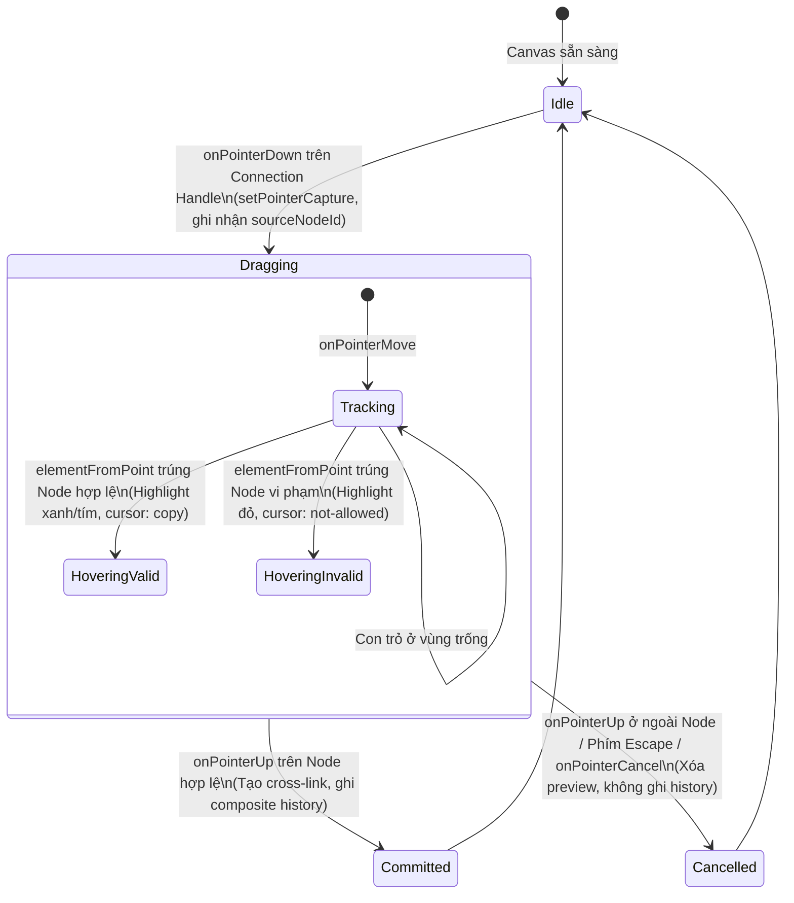

# Đặc Tả Kỹ Thuật: Milestone M5b — Canvas Direct Drag-to-Connect Interaction

**Ngày đề xuất:** 2026-10-12\
**Người phụ trách:** Staff Software Engineer kiêm Technical Architect\
**Trạng thái:** 📋 **PROPOSED ONLY (Chờ xem xét và phê duyệt từ Tech Lead / Product Owner)**\
**Phạm vi:** Mind Map Studio — Tương tác trực tiếp trên Canvas trong chế độ `saved-document`\
**Tài liệu tham chiếu:**
- Đặc tả M5a: [`docs/specs/m5-cross-link-editing.md`](m5-cross-link-editing.md)
- Kiến trúc working state M5a: [`docs/adr/ADR-M5-001-cross-link-working-state.md`](../adr/ADR-M5-001-cross-link-working-state.md)
- Kiến trúc history & pruning M5a: [`docs/adr/ADR-M5-002-cross-link-history-and-pruning.md`](../adr/ADR-M5-002-cross-link-history-and-pruning.md)
- Báo cáo phân tích hiện trạng M5b: [`docs/planning/M5-observe-orient.md`](../planning/M5-observe-orient.md)
- Kiến trúc tương tác M5b: [`docs/adr/ADR-M5-003-canvas-drag-to-connect-architecture.md`](../adr/ADR-M5-003-canvas-drag-to-connect-architecture.md)
- Thành phần Canvas: [`src/components/mindmap/MindMapTreeCanvas.tsx`](../../src/components/mindmap/MindMapTreeCanvas.tsx)
- Lớp liên kết chéo SVG: [`src/components/mindmap/MindMapCrossLinksLayer.tsx`](../../src/components/mindmap/MindMapCrossLinksLayer.tsx)
- Pure validation engine: [`src/lib/mindmapCrossLinks.ts`](../../src/lib/mindmapCrossLinks.ts)

---

## 1. Bối Cảnh, Mục Tiêu & Phạm Vi (Context, Goals & Scope)

### 1.1. Bối cảnh
Trong Milestone M5a, hệ thống đã hoàn thiện luồng biên tập liên kết chéo qua **Node Drawer (Drawer-Centric UI)**, thiết lập thành công:
1. Runtime state độc lập `workingDocumentCrossLinks`.
2. Hệ thống hoàn tác/làm lại composite snapshot `{ tree, crossLinks }`.
3. Bộ quy tắc thẩm định tính toàn vẹn `validateCrossLinkMutation` (chặn self-link, duplicate edge, cycle).
4. Thu dọn tự động cạnh mồ côi `pruneDanglingCrossLinks` khi xóa node.

Tuy nhiên, thao tác tạo liên kết chéo hiện tại đòi hỏi người dùng phải: Mở Drawer ➔ Chọn node đích trong dropdown ➔ Chọn loại quan hệ ➔ Bấm nút thêm. Đây là quy trình an toàn và đầy đủ tính năng nhưng chưa mang lại cảm giác trực quan, nhanh chóng của một bảng vẽ sơ đồ tư duy hiện đại.

### 1.2. Mục tiêu kỹ thuật của M5b (Goals)
- Bổ sung cử chỉ **kéo thả trực tiếp từ node nguồn sang node đích trên Canvas (Drag-to-Connect)** để tạo liên kết chéo.
- Giữ vững nguyên tắc **Zero Blast Radius**: Tách biệt hoàn toàn cử chỉ kéo nối với cử chỉ kéo đổi cấu trúc cây (HTML5 DnD Reparenting), cuộn canvas (Pan), và quét chọn (Marquee selection).
- Tích hợp 100% với hạ tầng validation, history composite snapshot, và save workflow đã được kiểm chứng tại M5a.
- Cung cấp phản hồi hình ảnh thời gian thực (real-time visual feedback) mượt mà 60fps qua Pointer Events API và đường cong Bézier preview.

### 1.3. Giới hạn ngoài phạm vi (Explicitly Out-of-Scope)
- ❌ Không thay thế hoặc làm hỏng tính năng kéo đổi cha con phân cấp (Tree Reparenting HTML5 DnD).
- ❌ Không biến canvas thành trình vẽ đồ thị tự do tùy biến (Full freeform graph editor).
- ❌ Không cho phép nối vào 4 cạnh tự do trên mỗi node; chỉ sử dụng cổng kết nối chuẩn hóa.
- ❌ Không thay đổi cấu trúc lưu trữ cơ sở dữ liệu hoặc schema `MindMapDocumentEdge`.
- ❌ Không thực hiện tự động lưu ngầm (Auto-persist) khi vừa nối xong.
- ❌ Không loại bỏ luồng Drawer-Centric; Drawer tiếp tục là công cụ biên tập chi tiết và là chốt chặn hỗ trợ tiếp cận (A11y baseline).

---

## 2. Các Sự Thật Đã Được Xác Minh (Verified Facts)

1. **Node Card Drag Ownership**: Thẻ node (`[data-node-id]`) hiện mang thuộc tính `draggable={isEditable && !isRoot}` sử dụng API HTML5 Drag-and-Drop (`onDragStart`, `dataTransfer`) phục vụ tái cấu trúc cây (`onReparentNode`).
2. **Backdrop Pointer Ownership**: Vùng nền `backdropRef` bắt sự kiện `onPointerDown` (`button === 0`) cho hai mục đích:
   - Nếu `e.shiftKey`: Kích hoạt **Marquee selection** bằng `setPointerCapture`.
   - Nếu không giữ `Shift`: Kích hoạt **Canvas Pan**.
   - Bộ lọc `target?.closest('[data-node-id], button, input, ...')` bỏ qua pointer down nếu bắt nguồn từ bên trong thẻ node.
3. **Không gian tọa độ 3 lớp**:
   - `Client Space`: Tọa độ chuột gốc `(clientX, clientY)`.
   - `Backdrop Space`: Tọa độ cuộn viewport (`scrollLeft`, `scrollTop`).
   - `Content Space`: `<div ref={containerRef}>` bị biến đổi bởi `translate(pan.x, pan.y) scale(zoom)`.
4. **Validation Engine đã sẵn sàng**: Hàm `validateCrossLinkMutation(sourceId, targetId, edgeType, existingEdges, treeRoot)` đã chạy kiểm thử độc lập 100% PASS và có sẵn các mã lỗi chuẩn: `CANNOT_LINK_SELF`, `DUPLICATE_CROSS_LINK`, `CYCLE_DETECTED`.

---

## 3. Mô Hình Tương Tác & Giao Diện Người Dùng (Interaction Model)

### 3.1. Cổng Kết Nối Chuyên Biệt (Dedicated Connection Handle / Port)
- **Vị trí**: Nút tròn nhỏ (Connection Port) nằm ở mép phải của thẻ node (đối với layout ngang `tree_horizontal`) hoặc mép dưới (đối với layout dọc `tree_vertical`).
- **Affordance**:
  - Chỉ hiển thị khi `isEditable === true` trong chế độ `saved-document`.
  - Xuất hiện với độ mờ nhẹ khi hover vào thẻ node hoặc khi node đang được chọn/focus (`data-testid="connector-handle-${node.id}"`).
  - Con trỏ chuyển thành `crosshair` khi hover lên Connection Handle.
- **Cách ly tuyệt đối**:
  - Toàn thân thẻ node tiếp tục dùng cho Reparenting DnD và Selection.
  - Người dùng **chỉ có thể bắt đầu Drag-to-Connect khi nhấn giữ chuột tại Connection Handle**. Bắt đầu kéo từ bất kỳ vùng nào khác của thẻ node sẽ không kích hoạt Drag-to-Connect.

```text
+------------------------------------+
| [Icon] Tiêu đề Node                |
|                                    | ===== (Kéo thân: Reparenting DnD)
| Tag: Tiên quyết                    |
+------------------------------------+---(o) <--- Connection Handle (Kéo cổng: Drag-to-Connect)
```

### 3.2. Vòng Đời Cử Chỉ Dựa Trên Pointer Events (Pointer Lifecycle State Machine)



1. **PointerDown (Khởi động)**:
   - Xảy ra trên `connector-handle-${node.id}`.
   - Gọi `e.stopPropagation()` và `e.preventDefault()`.
   - Gọi `e.currentTarget.setPointerCapture(e.pointerId)`.
   - Thiết lập trạng thái kết nối runtime:
     - `connectingSourceId = node.id`
     - `startPoint = { clientX, clientY }`
     - `currentPointer = { clientX, clientY }`
     - `candidateTargetId = null`
     - `validationState = null`
2. **PointerMove (Theo dõi & Hit-Testing)**:
   - Cập nhật `currentPointer = { clientX: e.clientX, clientY: e.clientY }`.
   - Tìm kiếm phần tử bên dưới con trỏ:
     ```ts
     const elem = document.elementFromPoint(e.clientX, e.clientY);
     const targetCard = elem?.closest<HTMLElement>("[data-node-id]");
     const targetId = targetCard?.getAttribute("data-node-id") || null;
     ```
   - Nếu `targetId` tồn tại và khác `connectingSourceId`:
     - Chạy `validateCrossLinkMutation(sourceId, targetId, "related", workingLinks, tree)`.
     - Cập nhật `candidateTargetId = targetId`.
     - Cập nhật `validationState = { valid: boolean, error?: string }`.
   - Nếu con trỏ ở vùng trống: `candidateTargetId = null`, `validationState = null`.
3. **PointerUp (Thả chuột / Cam kết)**:
   - Giải phóng `releasePointerCapture(e.pointerId)`.
   - Nếu `candidateTargetId` hợp lệ (`validationState.valid === true`):
     - Tạo một `MindMapDocumentEdge` mới với `edgeType = "related"` (hoặc loại được cấu hình).
     - Đẩy vào `workingDocumentCrossLinks` và ghi nhận một snapshot nguyên tử vào `historyState`.
     - Kích hoạt Dirty state: `isDirty = true`.
     - Hiển thị Toast thông báo hoặc mở Drawer tại node nguồn để xem/sửa nhãn (Handoff).
   - Nếu thả vào khoảng trống hoặc node không hợp lệ:
     - Hủy bỏ đường nối preview.
     - Không thay đổi dữ liệu, không ghi history.
4. **PointerCancel / Escape (Hủy thao tác)**:
   - Nhấn phím `Escape` hoặc mất tiêu điểm con trỏ (`onPointerCancel`): Lập tức dọn dẹp state kéo, đưa canvas về trạng thái `Idle`.

---

## 4. Mô Hình Chuyển Đổi Tọa Độ & Mặt Phẳng Vẽ Preview (Coordinate & Rendering Plane)

### 4.1. So sánh hai phương án mặt phẳng vẽ đường preview
- **Phương án A (Content Space Plane)**: Vẽ đường preview SVG bên trong `<div ref={containerRef}>`.
  - *Nhược điểm*: Phải chia tọa độ chuột `(clientX - containerRect.left)` cho `zoom` ở mỗi khung hình 60fps. Dễ xảy ra giật lag hoặc sai lệch pixel khi viewport đang zoom/pan.
- **Phương án B (Backdrop / Client Overlay Plane — Đề xuất)**: Vẽ đường preview SVG trong một lớp phủ tạm thời đặt trực tiếp bên trong `backdropRef` (cùng cấp với `marqueeBox`), sử dụng tọa độ màn hình Client thuần túy.
  - *Ưu điểm*:
    - Điểm bắt đầu `(startX, startY)` lấy trực tiếp từ `handleElement.getBoundingClientRect()`.
    - Điểm kết thúc `(endX, endY)` chính là `(e.clientX, e.clientY)`.
    - Hoàn toàn miễn nhiễm với CSS `scale(zoom)` và `translate(pan)`.
    - Thuật toán đơn giản, nhẹ, chính xác đến từng pixel con trỏ chuột.

### 4.2. Hình học đường cong Bézier preview
Đường nối tạm thời được vẽ dạng đường cong Cubic Bézier mượt mà:
$$P_0 = (\text{startX}, \text{startY}), \quad P_3 = (\text{currentX}, \text{currentY})$$
$$P_1 = (\text{startX} + dx \cdot 0.4, \text{startY}), \quad P_2 = (\text{currentX} - dx \cdot 0.4, \text{currentY})$$
- **Màu sắc trạng thái**:
  - Đang kéo ở vùng trống: Màu chàm mờ (`stroke-indigo-400/60`, nét đứt `stroke-dasharray="4 4"`).
  - Hover node hợp lệ: Màu xanh chàm đậm (`stroke-indigo-600 dark:stroke-indigo-400`, nét liền, mũi tên phát sáng).
  - Hover node vi phạm (self/duplicate/cycle): Màu đỏ hồng cảnh báo (`stroke-rose-500`, nét đứt, cursor `not-allowed`).

---

## 5. Quy Tắc Thẩm Định & Phản Hồi Trực Quan (Validation & Feedback Model)

1. **Tự liên kết (Self-Link)**:
   - Khi con trỏ rê lại chính node nguồn: Cạnh preview chuyển sang màu đỏ, hiển thị tooltip hoặc viền đỏ trên node nguồn (`CANNOT_LINK_SELF`). Thả chuột sẽ bị từ chối.
2. **Cạnh trùng lặp (Duplicate Edge)**:
   - Nếu giữa node nguồn và node đích đã tồn tại liên kết cùng loại: Báo trạng thái từ chối (`DUPLICATE_CROSS_LINK`).
3. **Chu trình (Cycle Rejection theo chính sách M5a)**:
   - Nếu node đích là tổ tiên hoặc đường đi ngược lại tạo chu trình khép kín: Hiển thị phản hồi từ chối (`CYCLE_DETECTED`).
4. **Target Node Affordance**:
   - Khi lướt qua node hợp lệ: Thẻ node đích nhận viền phát sáng `ring-2 ring-indigo-500 shadow-md bg-indigo-50/50`.
   - Khi lướt qua node không hợp lệ: Thẻ node đích nhận viền cảnh báo `ring-2 ring-rose-500/60 bg-rose-50/40`.

---

## 6. Handoff Sau Khi Thả Chuột & Quản Lý Lịch Sử (Post-Drop & History Integration)

### 6.1. Quyết định luồng sau khi Drop (Post-Drop Flow)
- **Đề xuất**: **Tạo tức thì loại mặc định `related` + Mở Drawer để tinh chỉnh (Immediate Create + Drawer Handoff)**.
- **Lý do**:
  - Không làm gián đoạn dòng suy nghĩ của người dùng bằng popup bắt buộc.
  - Người dùng có thể kéo nối liên tục nhiều node mà không bị modal chặn màn hình.
  - Nếu muốn đổi loại quan hệ sang `prerequisite`, `advanced` hay thêm nhãn chi tiết, Drawer bên phải đã mở sẵn danh sách liên kết của node đó để người dùng chỉnh sửa trong 1 cú click.

### 6.2. Hợp đồng Hoàn Tác / Làm Lại (Undo / Redo Contract)
- Thao tác kéo nối thành công được đóng gói thành một giao dịch nguyên tử (Atomic Mutation):
  - Đẩy snapshot `{ tree, crossLinks: [...prevLinks, newEdge] }` vào stack lịch sử.
  - Nhấn `⌘Z` (Undo): Xóa ngay lập tức cạnh vừa tạo khỏi canvas và working state.
  - Nhấn `⇧⌘Z` (Redo): Phục hồi lại cạnh vừa tạo.
- Thao tác kéo bị hủy hoặc thả không hợp lệ: **Không tác động vào history stack**.

---

## 7. Ranh Giới Khả Năng Tiếp Cận (Accessibility & Keyboard Boundary)

- Tính năng Drag-to-Connect trên Canvas là một **lối tắt nâng cao (Pointer-Enhanced Shortcut)** phục vụ tốc độ làm việc bằng chuột.
- **Không phải là con đường duy nhất**: Toàn bộ chức năng tạo, sửa, xóa liên kết chéo vẫn được bảo toàn 100% qua bàn phím tại **Node Drawer UI** (đã xây dựng và kiểm thử ở M5a).
- Người dùng chỉ sử dụng bàn phím (Keyboard-Only Users) hoặc trình đọc màn hình tiếp tục điều hướng cây qua phím mũi tên ➔ Nhấn `Enter`/`Space` chọn node ➔ Sử dụng phím `Tab` để nhập form thêm liên kết trong Drawer mà không gặp bất kỳ rào cản nào.

---

## 8. Các Câu Hỏi Mở (Open Questions Requiring Feedback)

1. **Vị trí Connection Handle**: Có nên đặt cố định ở cạnh phải thẻ node (luồng từ trái sang phải), hay hiển thị ở cả 4 cạnh khi hover? *(Khuyến nghị: Chỉ đặt ở cạnh phải cho layout ngang và cạnh dưới cho layout dọc để giảm thiểu clutter UI)*.
2. **Loại liên kết mặc định**: Có nên luôn luôn gán `related`, hay ghi nhớ loại liên kết được chọn gần nhất trong phiên làm việc của Drawer? *(Khuyến nghị: Mặc định `related` cho phiên bản M5b ban đầu để đảm bảo tính xác định cao nhất)*.
3. **Phản hồi sau khi thả**: Sau khi drop thành công, có nên tự động mở Drawer không, hay chỉ hiển thị một Toast nhỏ *"Đã tạo liên kết chéo"* để tránh che khuất canvas khi đang vẽ nhanh? *(Khuyến nghị: Hiển thị Toast tinh gọn, chỉ mở Drawer khi người dùng click vào node hoặc nhấp vào Toast)*.

---

## 9. Tiêu Chí Nghiệm Thu (Acceptance Criteria)

- [ ] Connection Handle chỉ hiển thị khi `isEditable === true` trong chế độ `saved-document`.
- [ ] Bắt đầu kéo từ Connection Handle không kích hoạt pan, không kích hoạt marquee, không kích hoạt reparenting.
- [ ] Đường cong Bézier preview bám sát tọa độ con trỏ chuột thời gian thực ở mọi mức `zoom` (0.5x - 2.0x) và `pan`.
- [ ] Rê qua node hợp lệ hiển thị chỉ báo chấp nhận (xanh/tím); rê qua node vi phạm (self, duplicate, cycle) hiển thị chỉ báo từ chối (đỏ).
- [ ] Thả chuột lên node hợp lệ tạo đúng 1 `MindMapDocumentEdge` trong `workingDocumentCrossLinks` và kích hoạt `isDirty = true`.
- [ ] Thả chuột ở vùng trống hoặc node vi phạm không tạo cạnh, không ghi history.
- [ ] Nhấn phím `Escape` khi đang kéo lập tức hủy bỏ đường preview mà không sinh ra tác dụng phụ.
- [ ] Hoàn tác `⌘Z` gỡ bỏ cạnh vừa tạo; Làm lại `⇧⌘Z` khôi phục lại cạnh.
- [ ] Toàn bộ các thao tác kéo Reparenting từ thân node và quét chọn Marquee bằng `Shift` tiếp tục hoạt động nguyên vẹn 100%.

---

## 10. Bộ Kịch Bản Gherkin Dự Thảo (Draft Gherkin Acceptance Scenarios)

```gherkin
Feature: Canvas Direct Drag-to-Connect for Cross-Links
  As a visual mind map author in saved-document mode
  I want to drag a connection line from a node's connection handle to another node
  So that I can quickly create cross-links directly on the canvas without opening form dropdowns

  Background:
    Given I am in "saved-document" mode with an editable document
    And the canvas contains "node-a", "node-b", and "node-c"
    And "showCrossLinks" toggle is enabled

  Scenario: 1. Start drag from connection handle
    Given I hover over "node-a" to reveal its connection handle
    When I press and hold pointer down on the connection handle of "node-a"
    Then the drag-to-connect session should start with source "node-a"
    And pointer capture should be acquired by the handle

  Scenario: 2. Do not start drag from node body
    When I press and drag on the body of "node-b"
    Then HTML5 reparenting drag should activate if valid
    And no drag-to-connect session should be started

  Scenario: 3. Preview line follows pointer during drag
    Given I have started drag-to-connect from "node-a"
    When I move the pointer across the canvas
    Then a Bézier preview curve should render from "node-a" connection handle to current pointer coordinates
    And the preview curve should follow the pointer accurately under zoom and pan transforms

  Scenario: 4. Hover valid target highlights accept state
    Given I am dragging a connection from "node-a"
    When the pointer hovers over valid target "node-b"
    Then "node-b" should display an accept highlight outline
    And the preview line should render in indigo styling with a connectable arrow

  Scenario: 5. Hover self target shows reject state
    Given I am dragging a connection from "node-a"
    When the pointer moves back over "node-a"
    Then "node-a" should display a reject highlight outline
    And the preview line should render in rose warning styling
    And the cursor should indicate an invalid operation

  Scenario: 6. Hover duplicate target shows reject state
    Given a cross-link already exists between "node-a" and "node-b" with type "related"
    And I am dragging a connection from "node-a"
    When the pointer hovers over "node-b"
    Then "node-b" should display a reject highlight outline
    And the validation state should indicate "DUPLICATE_CROSS_LINK"

  Scenario: 7. Hover cycle-forming target shows reject state
    Given "node-a" is an ancestor of "node-c"
    And I am dragging a connection from "node-c"
    When the pointer hovers over ancestor "node-a"
    Then "node-a" should display a reject highlight outline
    And the validation state should indicate "CYCLE_DETECTED"

  Scenario: 8. Drop on valid target creates one cross-link
    Given I am dragging a connection from "node-a"
    And the pointer is hovering over valid target "node-b"
    When I release the pointer (pointerup)
    Then a new cross-link from "node-a" to "node-b" should be added to workingDocumentCrossLinks
    And the preview line should be replaced by a permanent Bézier cross-link
    And isDirty should become true

  Scenario: 9. Drop on invalid target creates nothing
    Given I am dragging a connection from "node-a"
    And the pointer is hovering over self target "node-a"
    When I release the pointer (pointerup)
    Then the preview line should disappear
    And no new cross-link should be created
    And workingDocumentCrossLinks should remain unchanged

  Scenario: 10. Cancel via Escape creates nothing
    Given I am dragging a connection from "node-a"
    When I press the "Escape" key
    Then the drag-to-connect session should immediately terminate
    And the preview line should be removed from the canvas
    And working state should remain untouched

  Scenario: 11. Undo after successful drag removes created edge
    Given I successfully dragged and created a cross-link from "node-a" to "node-b"
    When I press "⌘Z" or "Ctrl+Z" (Undo)
    Then the created cross-link should disappear from the canvas
    And workingDocumentCrossLinks should revert to its prior state

  Scenario: 12. Redo restores created edge
    Given I undid the cross-link created via drag-to-connect
    When I press "⇧⌘Z" or "Ctrl+Y" (Redo)
    Then the cross-link should be restored onto the canvas
    And workingDocumentCrossLinks should contain the restored edge

  Scenario: 13. Existing pan does not start while drag-to-connect is active
    Given I am dragging a connection from "node-a"
    When the pointer moves across empty canvas areas
    Then the canvas pan position (panX, panY) should remain unchanged

  Scenario: 14. Existing marquee does not activate from connection handle
    Given I hold the "Shift" key
    When I press pointer down on the connection handle of "node-a"
    Then drag-to-connect should activate instead of marquee selection
    And no marquee bounding box should render

  Scenario: 15. Existing node reparent drag still works from node body
    Given "node-b" is a non-root node
    When I drag "node-b" by its card body onto "node-c"
    Then onReparentNode should be triggered for "node-b" and "node-c"
    And no cross-link should be generated
```
