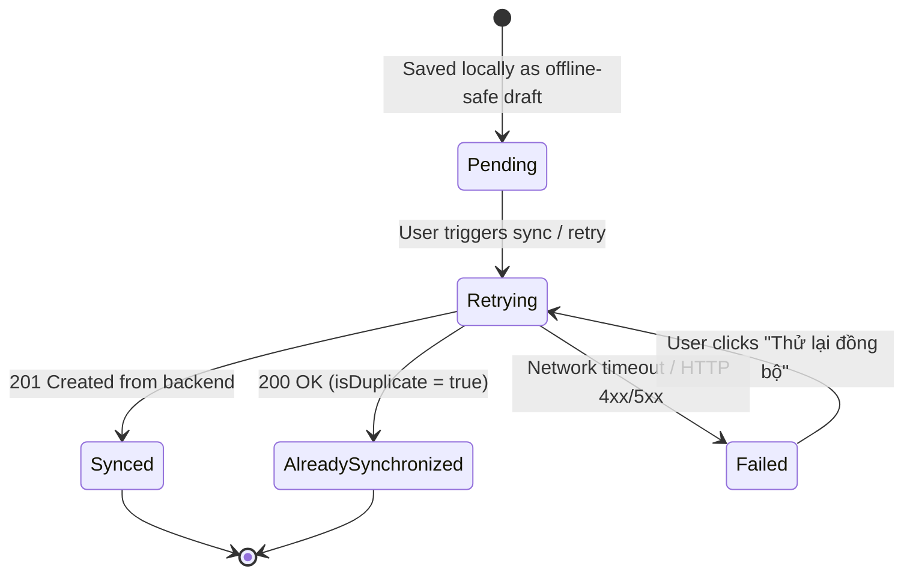
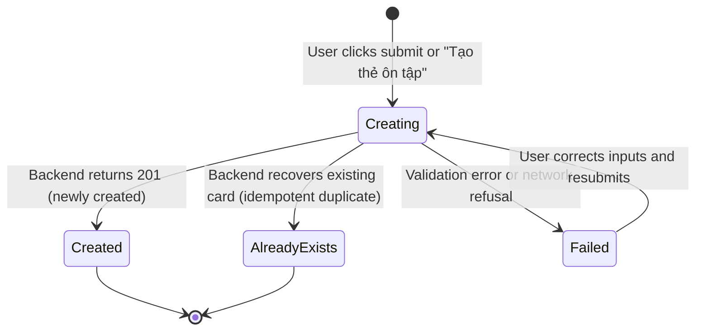

# Functional Specification: Phase 25 — UX Polish & Product Experience

## 1. Context & Background
Knowledge OS has released `v0.1.1` (commit `f223770d97cd6ef9f56a5d65c71f0c538d99f9a7`), hardening the foundation with:
- Flashcard backend idempotency with unique index and P2002 recovery.
- NotebookLM artifact ingest contract alignment (10 distinct types).
- Production migration safety guards (`safe-prisma-db-push.mjs`).
- Structured observability for idempotent recovery and duplicate detection.
- Fail-fast automated backups with SHA-256 verification and min-keep retention.

While the backend infrastructure is robust, the front-end user experience exhibits gaps in feedback clarity, empty states, and destructive action safety:
1. Artifact sync states do not clearly distinguish between pending, retrying, failed, and already-synchronized.
2. Flashcard creation from MindMap and forms does not explicitly tell users whether a card was freshly created or recovered as an existing duplicate.
3. MindMap presents a dead-end message when zero nodes/topics exist, rather than a welcoming onboarding path.
4. MindMap has rich keyboard navigation but no discoverable shortcut cheatsheet or overlay.
5. Backup restoration from Auto-Backup snapshot ring buffer lacks an explicit confirmation prompt.

## 2. Goals & Non-Goals

### 2.1 Goals
- **Clarity of System State**: Provide unambiguous visual feedback for asynchronous, idempotent, and error states.
- **Actionable Error & Retry**: Ensure every failed sync or creation provides an explicit, safe path to retry.
- **Zero-Dead-End Onboarding**: Guide users with a primary CTA and minimal 1-3 step guidance when entering empty views.
- **Safety by Default**: Require explicit confirmation for all destructive restore operations across both server snapshots and local auto-backup ring buffers.
- **Zero Regression**: Preserve 100% of existing contracts, Zero-Default universal baseline, and test hermeticity.

### 2.2 Non-Goals
- No new features outside MindMap, NotebookLM, Flashcard/SRS, and Backup/Restore.
- No database migrations, schema alterations, or data resets.
- No extensive interactive tutorials or animated tours.
- No breaking API changes or alterations to existing released endpoints.

---

## 3. Detailed UX State Models

### 3.1 NotebookLM Artifact Synchronization State Model

The artifact locker currently models `syncStatus?: 'synced' | 'pending' | 'failed'`.
Phase 25 standardizes the UI presentation into 5 deterministic states:

| UX State | Badge Display | Color / Visual Token | Actions Available | User Hint |
| :--- | :--- | :--- | :--- | :--- |
| **Pending** | `Chờ đồng bộ` | Amber background / border | `Thử lại đồng bộ` | Đã lưu an toàn trong trình duyệt, sẵn sàng đẩy lên máy chủ |
| **Retrying** | `Đang đồng bộ...` | Amber background with spinning `RefreshCw` | Disabled / loading | Đang gửi yêu cầu xác thực và nạp artifact lên máy chủ... |
| **Synced** | `Đã đồng bộ` | Emerald background / Check icon | `Thẩm định & Nhập`, `Mở Notebook` | Đã lưu trữ toàn vẹn trên máy chủ (Grounded Artifact) |
| **AlreadySynchronized** | `Đã lưu trên máy chủ` | Sky / Indigo background / CheckCheck icon | `Thẩm định & Nhập`, `Mở Notebook` | Artifact này đã tồn tại trên máy chủ (khớp idempotencyKey); không tạo bản ghi trùng |
| **Failed** | `Lỗi đồng bộ` | Rose background / AlertCircle icon | `Thử lại đồng bộ`, `Xóa cục bộ` | Kết nối gián đoạn hoặc lỗi xác thực. Bấm để thử lại an toàn |

### 3.2 Flashcard Creation Feedback State Model

When creating flashcards (from `FlashcardFormModal`, `MindMapNodeDrawer`, or `UnifiedResearchReader`), the UI handles 4 states:

| UX State | Visual Feedback | Toast Notification | Action Result |
| :--- | :--- | :--- | :--- |
| **Creating** | Button disabled with spinner (`Loader2` / `isSubmitting`) | None | Input locked against double-click race conditions |
| **Created** | Form closes cleanly; Card view highlights | `Đã tạo thẻ ôn tập thành công!` (Type: `success`) | New card appended to deck and review queue |
| **AlreadyExists** | Form closes cleanly or highlights existing card in drawer | `Thẻ này đã tồn tại trong chủ đề (không tạo trùng)` (Type: `info`) | Existing card surfaced; duplicates prevented |
| **Failed** | Inline error message banner with `AlertCircle` | `Lỗi: [Chi tiết lỗi]` (Type: `error`) | Form stays open; inputs preserved for recovery |

### 3.3 MindMap Empty State & Onboarding

When a workspace or topic has no mindmap nodes or no topics exist:
- **Hero Icon**: Distinct `Network` icon with subtle indigo/blue accent ring.
- **Headline**: "Bắt đầu xây dựng sơ đồ tư duy" (Clean, affirmative tone replacing "Không thể sinh sơ đồ tư duy").
- **Description**: "Trực quan hóa cấu trúc kiến thức bằng các nhánh khái niệm và liên kết đa chiều."
- **Primary CTA**: Button `Tạo sơ đồ đầu tiên` (or `Tạo chủ đề đầu tiên` if 0 topics).
- **Secondary CTA**: Button `Nhập Outline từ Markdown / NotebookLM` (opens `MindMapImportPreviewModal`).
- **Quick-Start Onboarding (3 micro-steps)**:
  1. `Tab`: Tạo nút con từ nút hiện tại.
  2. `Enter`: Tạo nút ngang hàng.
  3. `F2`: Đổi tên nhanh nút được chọn.

### 3.4 MindMap Keyboard Shortcut Overlay

- Accessible on pressing `?` or clicking a toolbar pill `Phím tắt (?)`.
- Modal/Drawer that presents a searchable or structured list of **strictly implemented** shortcuts:
  - Navigation: Arrow keys (`↑`, `↓`, `←`, `→`), `Home`.
  - Node Editing: `Tab` (Add child), `Enter` (Add sibling), `F2` (Rename), `Delete` / `Backspace` (Delete).
  - Selection: `Cmd+A` / `Ctrl+A` (Select visible nodes), `Escape` (Deselect).
  - Tree Organization: `Alt + ↑` / `Alt + ↓` (Move order in branch), `Space` (Toggle collapse).
  - Power Tools: `Shift + Space` (Quick Peek), `Shift + A` (AI Knowledge Expansion).
  - History: `Cmd + Z` (Undo), `Cmd + Shift + Z` / `Ctrl + Y` (Redo).
- Closes cleanly via `Escape`, click outside, or close button with focus returned to canvas.

### 3.5 Backup Restore Safety UX

- **Replace Mode Safeguard**:
  - Requires user to explicitly type `XÁC NHẬN THAY THẾ` into confirmation text field.
  - Displays in-memory `RestoreDrill` simulated impact (number of topics, notes, resources affected).
  - Takes automated `pre-restore` safety snapshot before execution.
- **Auto-Backup Snapshot Restore Safeguard**:
  - Adds an explicit confirmation modal / dialog before triggering `handleRestore`:
    "Khôi phục bản sao lưu này sẽ thay thế dữ liệu hiện tại trong không gian làm việc. Một bản lưu an toàn trước khi khôi phục sẽ tự động được ghi nhận. Bạn có chắc chắn muốn tiếp tục?"
  - Surfaces snapshot metadata: timestamp, SHA-256 fingerprint, entity count, and label.

---

## 4. Architectural Invariants Preserved
1. **Zero-Default Baseline**: No sample domains, categories, or topics injected into defaults.
2. **Test Hermeticity**: Unit tests run strictly hermetically without HTTP calls to `localhost:3000`.
3. **Database Integrity**: Zero schema changes; zero migration scripts.

